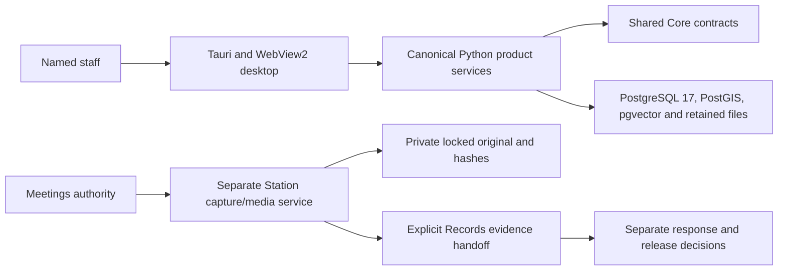

# Townlight Beta 1 architecture

Townlight setup bundles and provisions the Station service. Station runs as a separate process with its own database and media storage and hands verified originals to Records through explicit staff actions. Its media implementation uses CivicCast source. Standalone CivicCast retains its own repository, product, installation and data.

In the current Windows 1.9.3.2 release, named staff use existing staff roles to connect the Meetings and Records desktop client to a city-managed Windows host over private HTTPS. The shared host owns the database, managed files, Station and recording hardware; staff workstations use the same client and role-scoped access. A background publisher sends explicitly approved packet revisions and recordings to the configured resident portal. Records release decisions and resident-portal approvals are explicit staff actions. [Windows 1.9.3.2 release](https://github.com/townlight/townlight/releases/tag/townlight-windows-v1.9.3.2) · [Acceptance and limits](https://github.com/townlight/townlight/releases/download/townlight-windows-v1.9.3.2/ACCEPTANCE-Windows-1.9.3.2.md) · [Windows staff workflows](https://townlight.github.io/manuals/windows-staff-workflows.html) · [Portal guide](https://townlight.github.io/manuals/portal.html).

Local Ollama and model-dependent operations are explicit; deterministic staff workflows can proceed without local AI. Retained sources, citations, visibility, review state, Records release decisions and portal approvals define the evidence boundary. AI drafts do not create official decisions.

Use the [suite manual](https://townlight.github.io/manuals/suite.html), product architecture drawings and exact API, OpenAPI and protocol references for configuration and examples. The [Windows 1.9.3.2 release](https://github.com/townlight/townlight/releases/tag/townlight-windows-v1.9.3.2) identifies its signed installer, corresponding source and acceptance evidence. The historical [Windows 1.9.1.1 release](https://github.com/townlight/townlight/releases/tag/townlight-windows-v1.9.1.1) keeps its own source and acceptance identity.