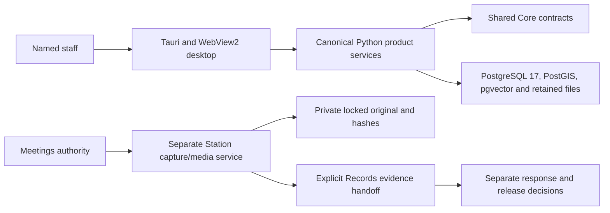

# Townlight Beta 1 architecture

The existing full desktop composition contains the eight original products plus
supporting Access/Notice. Station is a ninth product with separate database,
storage and CLI provisioning, paired explicitly with Townlight staff/meeting
authority. Its media implementation is pinned from CivicCast. Standalone
CivicCast retains its own repository, product, installation and data.

Local Ollama and model-dependent operations are explicit; deterministic staff
workflows can proceed without local AI. Retained sources, citations, visibility,
review state and separate Records release decisions define the evidence boundary.
AI drafts do not create official decisions.

Use the [suite manual](https://townlight.github.io/manuals/suite.html), product architecture drawings and exact API,
OpenAPI and protocol references for configuration and examples. The [release](https://github.com/townlight/townlight/releases/tag/townlight-beta-1)
separates accepted signed bytes from later source-integration commits and CI builds.
