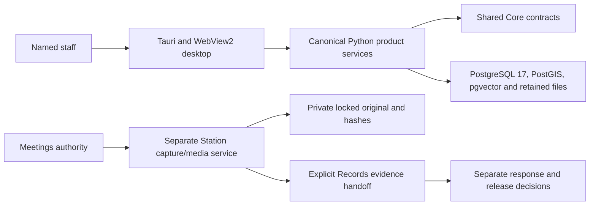

# Townlight Beta 1 architecture

The released Windows 1.9.1.1 installer configures the bundled Station service
during Townlight setup. Station retains its own database and media storage and
hands verified originals to Records through explicit staff actions. Its media
implementation uses CivicCast source. Standalone CivicCast retains its own
repository, product, installation and data.

In the signed 1.9.2.1 candidate, named staff connect the Meetings and Records
desktop client to a city-managed Windows host over private HTTPS. The host owns
the database, managed files, Station and recording hardware. A background
publisher sends explicitly approved packet revisions and recordings to the
configured resident portal. [Shared staff architecture and setup](https://github.com/townlight/townlight/blob/main/docs/installer/windows-shared-staff.md) · [Portal guide](https://townlight.github.io/manuals/portal.html).

Local Ollama and model-dependent operations are explicit; deterministic staff
workflows can proceed without local AI. Retained sources, citations, visibility,
review state and separate Records release decisions define the evidence boundary.
AI drafts do not create official decisions.

Use the [suite manual](https://townlight.github.io/manuals/suite.html), product architecture drawings and exact API,
OpenAPI and protocol references for configuration and examples. The [public Windows release](https://github.com/townlight/townlight/releases/tag/townlight-windows-v1.9.1.1)
separates accepted signed bytes from later source-integration commits and CI builds.
